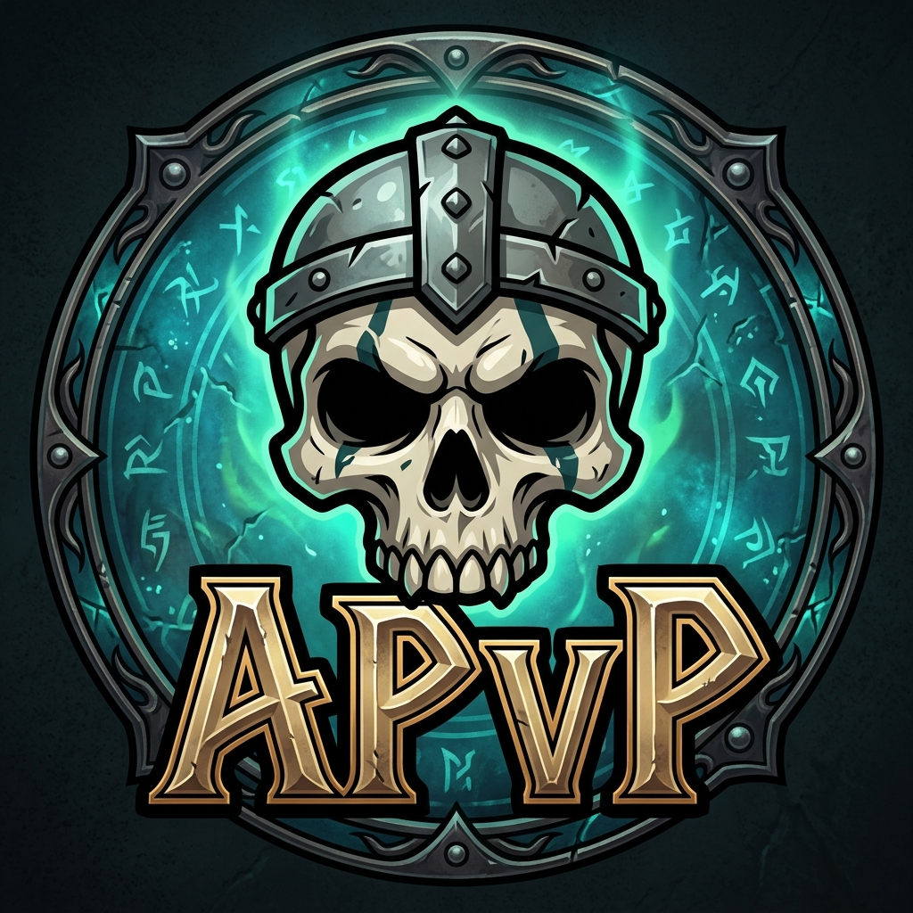

<p align="center">
  
</p>

# AndreddiPvP

An addon for **World of Warcraft: Forever** and **retail**. It keeps a history of the players and guilds you fight in open-world PvP.

## Install

Copy the `AndreddiPvP` folder into the client's AddOns folder:

| Client | AddOns folder |
|---|---|
| Forever | `World of Warcraft\_classic_beta_\Interface\AddOns\AndreddiPvP\` |
| Retail | `World of Warcraft\_retail_\Interface\AddOns\AndreddiPvP\` |

The folder must be named `AndreddiPvP`. Then reload or log in, and type `/apvp`.

## One project, two clients

Both clients share every `.lua` file. Each client loads the `.toc` whose suffix matches it:

| File | Client | Interface |
|---|---|---|
| `AndreddiPvP_Forever.toc` | WoW: Forever | 16001 |
| `AndreddiPvP_Standard.toc` | Retail (Midnight) | 120105 |

Keep the two file lists identical, and use the same `## Version` line in both.

When a patch changes the interface number, update the `## Interface` line in that client's `.toc`. You can check the current number in game with `/dump select(4, GetBuildInfo())`.

If one client ever needs its own file, list it in only that `.toc`.

### Character names

- **Retail:** players are stored as `Name-Realm`, and players from your own realm are shown without the realm.
- **Forever:** characters have a first name and a surname, and the game reports the surname where retail reports the realm. `AndreddiPvP_Forever.toc` contains `## X-NameStyle: Surname`, which tells the addon to store full names like `First Surname`. When you type a name by hand (slash commands, *Add player*, the killer box), use the full name. Capitalisation doesn't matter if the player is already known.

## Features

- **History.** Every kill and death is saved with the time, zone, level, class and guild.
- **Post-fight popup.** After a kill or death, a small window lets you put the player and their guild on a list and write a note. It closes on its own after 30 s; hovering or typing in it keeps it open.
- **Lists.** Players and whole guilds can go on *Kill on sight*, *Friendly* or *Ignore*. A player's own list wins over their guild's list.
- **Proximity alerts.** You get a toast, a sound and a chat line when someone from your history or lists shows up (nameplate, target, focus or mouseover). The toast shows your K/D against them, your last encounter, notes and list. Each category has its own sound (KOS, Friendly, known player). Ignored players never trigger an alert. Left-click a toast to target the player (out of combat only, since the game blocks addon targeting in combat). Right-click dismisses it.
- **Tooltip.** Player tooltips show your list, K/D against the player and their guild, your last encounter, and your notes.
- **Statistics.** This tab shows:
  - your overall K/D
  - kills and deaths today, this week, this month, this year and all time, plus averages
  - a 14-day chart
  - a breakdown by class
  - nemeses and favourite victims
  - the guilds you have killed most and died to most
  - a switch between all characters and the current one
- **Guilds.** Everything above also works per guild: lists, notes, K/D, alerts and statistics.

## How kill and death detection works on Forever

Forever gives addons **no combat log**: `COMBAT_LOG_EVENT_UNFILTERED` is forbidden. So:

- **Kills** come from the `PARTY_KILL` event when you or your pet land the killing blow. Kills by party members can be counted too (a setting, off by default).
- **Deaths:** `PLAYER_DEAD` doesn't say who killed you. The addon remembers enemy players that were targeting you in the last 20 s (the "suspect window" setting).
  - **One suspect:** the death is recorded against them automatically. The popup has a *Wrong player?* button.
  - **Several suspects:** the popup asks you to pick one.
  - **No suspects** (stealth, out of view, PvE death): nothing is recorded. Use `/apvp death` or *Record a death...* in the History tab to type the name.

By default, battlegrounds and arenas are not tracked.

## Slash commands

| Command | What it does |
|---|---|
| `/apvp` | Open or close the history window |
| `/apvp stats`, `/apvp settings` | Open a specific tab |
| `/apvp kos`, `friendly`, `ignore`, `clear` `[name]` | List your target or a named player (`Name-Realm` on retail, `First Surname` on Forever) |
| `/apvp gkos`, `gfriendly`, `gignore`, `gclear` `[Guild]` | List your target's guild or a named guild |
| `/apvp note <text>` | Set a note on your target |
| `/apvp death` | Record who killed you |
| `/apvp unlock`, `/apvp lock` | Move the alert anchor |
| `/apvp test` | Show test alerts |

The addon button next to the minimap opens history on left-click and settings on right-click.

## Custom sounds

Put `.ogg` or `.mp3` files in `AndreddiPvP\Sounds\`. Then add a line to `SOUND_CATALOG` in `UI/Alerts.lua`:

```lua
{ key = "mine", label = "My sound", file = "Interface\\AddOns\\AndreddiPvP\\Sounds\\mine.ogg" },
```

## Data

Everything is stored account-wide in `WTF\Account\<account>\SavedVariables\AndreddiPvP.lua`.
